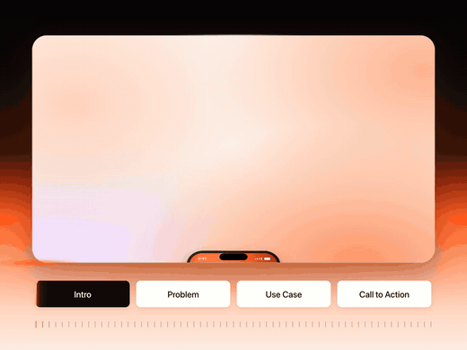

# Skills

Skills for Claude Code, each solving one real job end to end. Each one is tested on more than one case before it
lands here.

| Skill | What it does |
|---|---|
| [**Marquee**](marquee) | Hand it a product, get its launch film: a 15–60 s product video with smooth motion and music, from an idea, a link or screenshots |

## Install

Add this collection once, then install what you want:

```
/plugin marketplace add tariq659891/skills
/plugin install marquee@tariq
```

Or copy a skill's folder into `~/.claude/skills/` (each skill's README says which folder).

[](marquee/media/kept.mp4)

MIT licence.
