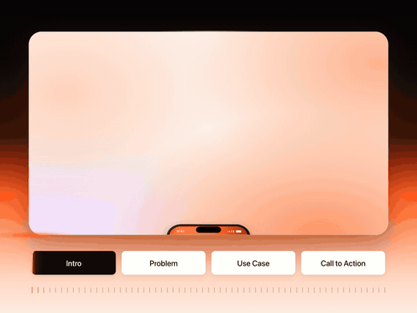
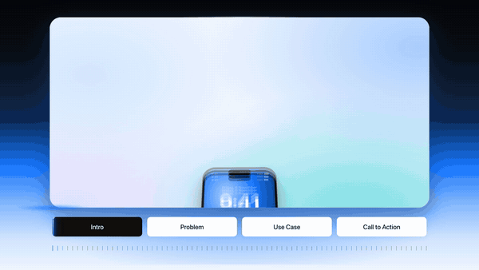

# Marquee

**Hand it a product, get its launch film.**

A Claude Code skill that turns a one-line idea, a website link or a few screenshots into a finished product film:
15–60 seconds, smooth motion, music and sound on every action, no voiceover. Everything is drawn and animated in one
HTML file, filmed frame by frame in Chrome, and scored from the film's own cues. No editor, no stock footage, nothing
to license.

[](media/kept.mp4)

*Kept (a made-up startup): 45 s, 4:3. [Watch the full film with sound](media/kept.mp4).*

## Use it

```
/plugin marketplace add tariq659891/skills
/plugin install marquee@tariq
```

Then ask for a film in plain words:

```
> make a launch film for https://your-startup.com
> a 30-second demo video for an app that splits rent between flatmates, 16:9, blue
> turn these screenshots into a product video for Reels   (attach them)
```

Claude reads the product, writes the story, builds the scenes, checks stills of every scene, renders, scores, and
hands you the MP4. It tells you anything it had to invent about the product. To change anything, ask: every word,
colour and timing is in `film.html`, and a re-render takes a minute or two.

Without the plugin system, copy the skill folder instead:

```
git clone https://github.com/tariq659891/skills
cp -r skills/marquee/skills/marquee ~/.claude/skills/
```

**You need:** Google Chrome, ffmpeg (`brew install ffmpeg`), Node 22+ or Bun, and Python 3 with numpy and soundfile
(`pip3 install numpy soundfile`).

## What a film is

Four chapters, with the chapter bar along the bottom so people know how much is left:

| Chapter | Share | What happens |
|---|---|---|
| Intro | ~14 % | the product on screen from the first frame, then the name. No logo intro |
| Problem | ~25 % | the feeling in short typed lines, then the problem as clutter or a moment of loss |
| Use case | ~47 % | one job, start to finish, in the product. Half the film is the product working |
| Call to action | ~14 % | a typed line, then the name, one sentence, where to get it |

The eight rules behind it, the timings for 15/30/45/60 seconds and how to write the words are in
[`guide/story.md`](skills/marquee/guide/story.md).

[](media/tandem.mp4)

*Tandem (also made up): 31 s, 16:9, built only from the engine's blocks. [Watch it with sound](media/tandem.mp4).*

## Motion

Motion is most of what makes it look like a film rather than a slideshow, so it has its own guide:
[`guide/motion.md`](skills/marquee/guide/motion.md). In short:

- **Every frame is calculated from the time.** No CSS animations and no timers, so nothing drops or stutters, and
  every render is identical.
- **Real motion blur**: `--blur 3` blends several moments per frame like a film camera's shutter.
- **Easing for each kind of move**: arrivals settle (out5), pops overshoot a little (back), moves from A to B ease
  both ends, departures are quick. Nothing arrives on a straight line.
- **Stagger, overlap, one hero move at a time, idle life**, depth from parallax, and one object followed through
  every scene.
- **A sound under every move that matters**, and one beat of silence before the turn.

## How it works

```
idea / link / screenshots
  → beat sheet (story.md)
  → film.html: the engine's blocks + scenes, everything a function of t
  → render.mjs --sheet / --stills   look at it, fix it, look again
  → render.mjs --blur 3             picture.mp4 (headless Chrome → ffmpeg)
  → score.py cues.json              score.wav: music shaped by the chapters, a sound for every cue
  → ffmpeg                          your-product.mp4
```

```
skills/marquee/
├── SKILL.md            the loop Claude follows
├── guide/              story · motion · scenes · look · sound
├── engine/
│   ├── kit.js          timing, easing, moves, typing, words, cues
│   ├── blocks/         frame + chapter bar, backgrounds, phone/desktop/browser, cards and icons,
│   │                   ring collage, finger and cursor, logo
│   ├── marquee.css     the shared look
│   ├── template.html   a film that runs as it stands, with every part to fill marked FILL
│   ├── render.mjs      headless Chrome → ffmpeg, no packages; --sheet, --stills, --blur, --fps, --audio
│   └── score.py        the generated score and effects
└── examples/
    ├── kept/           45 s, 4:3: the first film, one hand-written file
    └── tandem/         31 s, 16:9: built only from the engine
```

## What it can't do

No live-action footage, no realistic 3D, no voiceover, and the music is generated rather than produced. For a real
camera shot, Marquee can leave a placeholder for you to drop the clip into; for music, lay your own track (and
Marquee's sound effects) over the picture with one ffmpeg command ([`guide/sound.md`](skills/marquee/guide/sound.md)).

## Credit

The four-chapter structure, with its chapter bar, was learned from HowDo's launch film. Kept and Tandem are made-up
startups. Any resemblance to a real product with the same name is chance.

MIT licence.
